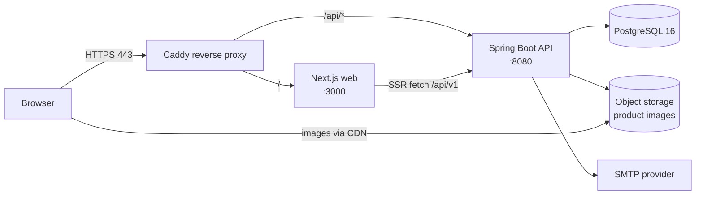
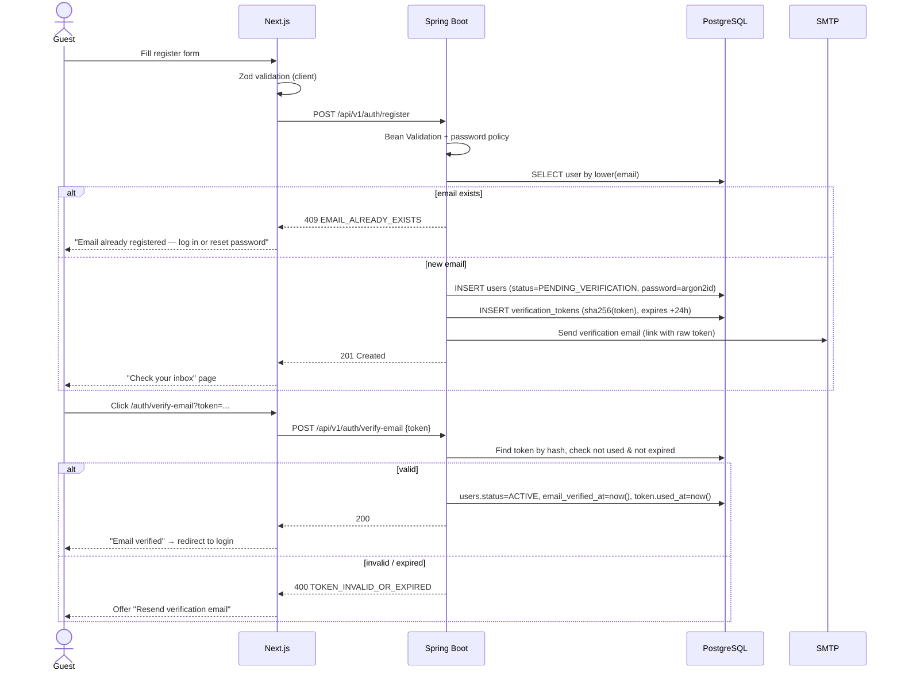
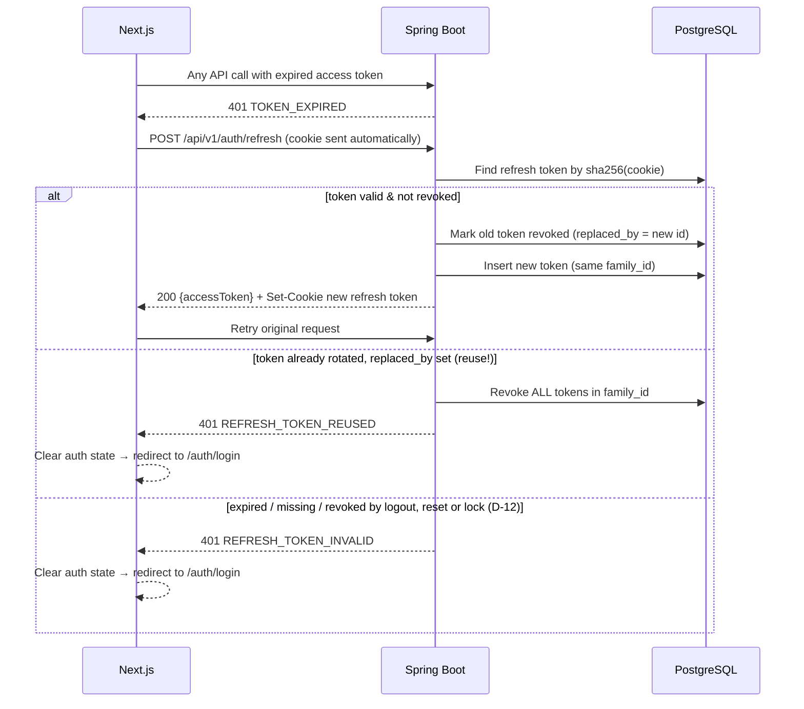
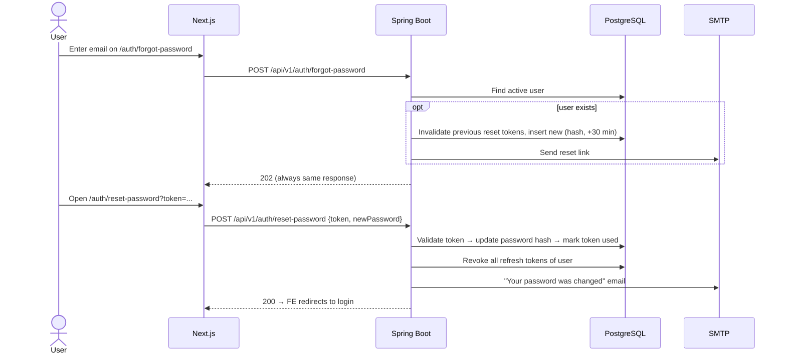
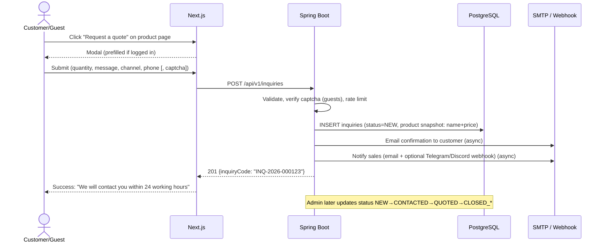
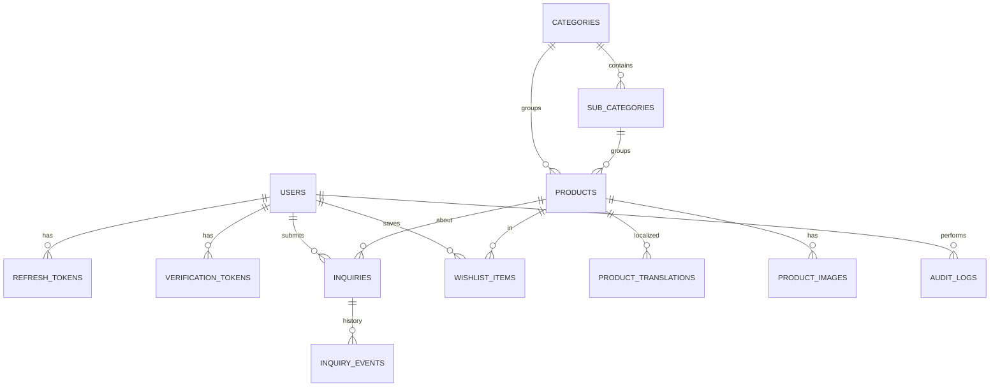
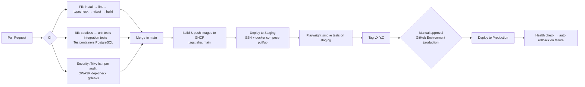

# Bee Store E-commerce — Software Requirements Specification (SRS)

> **Version:** 1.0 (draft) · **Date:** 2026-10-19 · **Status:** Proposed
> **Stack:** Next.js (FE) · Java / Spring Boot (BE) · PostgreSQL (DB) · Docker · GitHub Actions (CI/CD)

---

## Table of Contents

1. [Introduction](#1-introduction)
2. [Overall Description](#2-overall-description)
3. [Technology Stack & Database Choice](#3-technology-stack--database-choice)
4. [System Architecture](#4-system-architecture)
5. [Functional Requirements](#5-functional-requirements)
6. [Detailed Flows](#6-detailed-flows)
7. [Data Model](#7-data-model)
8. [REST API Specification](#8-rest-api-specification)
9. [Security Requirements](#9-security-requirements)
10. [Non-Functional Requirements](#10-non-functional-requirements)
11. [Repository Structure](#11-repository-structure)
12. [Docker & Local Development](#12-docker--local-development)
13. [CI/CD Pipeline](#13-cicd-pipeline)
14. [Environments & Configuration](#14-environments--configuration)
15. [Testing Strategy](#15-testing-strategy)
16. [Observability & Operations](#16-observability--operations)
17. [Roadmap](#17-roadmap)
18. [Glossary](#18-glossary)
19. [Decision Log](#19-decision-log)
20. [Backend Traceability Matrix](#20-backend-traceability-matrix)

---

## 1. Introduction

### 1.1 Purpose

This document specifies the requirements, architecture, data model, flows, and delivery pipeline of the **Bee Store** web application, a catalog-style e-commerce site for server and workstation hardware components (CPU, GPU, Mainboard, Cooler). It is the single reference for developers, testers, and stakeholders.

### 1.2 Product Scope

Bee Store is a **showcase and lead-generation website**, not a transactional store. It:

- **Publishes** a catalog of hardware components with rich, multilingual specifications, images, and prices.
- **Lets visitors register and log in** with a secure account.
- **Connects customers with the Bee Store team** through product inquiries / quote requests and contact channels (phone, Zalo, Messenger, email).

**Explicitly out of scope for v1:**

| Out of scope | Note |
|---|---|
| Online payment (gateway, card, e-wallet) | Sales are closed offline after the team contacts the customer. |
| Cart / checkout / order processing | Existing FE pages `cart/` and `checkout/` must be removed or hidden behind a feature flag. |
| Shipping & inventory integration | `stockStatus` is a manually maintained field. |
| Product reviews & ratings | Possible future feature. |

### 1.3 Definitions

See [Glossary](#18-glossary).

### 1.4 References

- Product source data: [`product/`](product/) (one folder per category → one folder per product, with `info/product.json`, `description.{en,vi,zh}.md`, `images/`, `CREDITS.txt`).
- Frontend code: [`fe/`](fe/) (Next.js 16, React 19, TanStack Query, Zustand, React Hook Form + Zod, Tailwind v4).
- Backend code: [`be/`](be/) (to be implemented).

---

## 2. Overall Description

### 2.1 Product Perspective

A standalone web system made of three deployable units (Next.js web app, Spring Boot REST API, PostgreSQL database) plus supporting services (reverse proxy, SMTP provider, object storage for images).

### 2.2 User Classes

| Role | Description | Authentication |
|---|---|---|
| **Guest** | Anonymous visitor. Browses the catalog, reads specs, switches language, sends a contact message. | None |
| **Customer** | Registered, email-verified user. Everything a Guest can do, plus: product inquiries tracked in their account, a saved wishlist, profile management. | Email + password (JWT) |
| **Admin** | Bee Store staff. Manages products, categories, images, inquiries, and users. | Email + password (JWT) + role `ADMIN` |

### 2.3 Product Catalog (current data)

| Category | Slug | Sub-categories | Items |
|---|---|---|---|
| CPU | `cpu` | Zen 2, Zen 3 | 11 (AMD EPYC 7402, 7532, 7642, 7663, 7B12, 7B13, 7F32, 7F52, 7K62, 7V13, 7V73X) |
| GPU | `gpu` | NVIDIA | 1 (Tesla A2) |
| Mainboard | `mainboard` | Gigabyte, Huananzhi | 3 (MZ71-CE1 2P, H12D-8D 1P, H12D-8D 1P BMC) |
| Cooler | `cooler` | AIO, Air | 5 (AIO 360 1P/2P, M95 Pro, M97, M99) |

Prices are in **VND**. Content is available in **English (en)**, **Vietnamese (vi, default)**, and **Chinese (zh)**.

### 2.4 Operating Environment

- Modern browsers (latest 2 versions of Chrome, Edge, Firefox, Safari; iOS Safari and Android Chrome).
- Server: Linux VPS (2 vCPU / 4 GB RAM is enough for v1) running Docker Engine and Docker Compose v2.

### 2.5 Constraints & Assumptions

- Small team and small traffic (fewer than 1,000 daily visitors and fewer than 1,000 products), so prefer simplicity over distributed architecture.
- Single region deployment (Vietnam / Singapore).
- Third-party image credits (`CREDITS.txt`) must be displayed on product pages where licenses require attribution (e.g. Free Art License, CC BY-SA).

---

## 3. Technology Stack & Database Choice

### 3.1 Recommended Database: **PostgreSQL 16**

For a small Java + Next.js project like this, **PostgreSQL** is the recommended choice:

| Criterion | PostgreSQL | MySQL / MariaDB | MongoDB |
|---|---|---|---|
| Relational data (users, tokens, inquiries) | ✅ Excellent | ✅ Excellent | ⚠️ Manual integrity |
| Flexible product specs (different per category) | ✅ `JSONB` + GIN index | ⚠️ `JSON` type, weaker indexing | ✅ Native |
| Multilingual content (en/vi/zh) | ✅ `JSONB` or translation table | ✅ Translation table | ✅ Native |
| Full-text search (product search) | ✅ Built-in `tsvector`, `pg_trgm` | ⚠️ Basic | ✅ Atlas Search (paid) |
| Spring Data JPA / Hibernate support | ✅ First-class | ✅ First-class | ⚠️ Different paradigm |
| Free managed hosting options | ✅ Neon, Supabase, Railway | ✅ PlanetScale (limited) | ✅ Atlas free tier |
| Docker image & Testcontainers | ✅ | ✅ | ✅ |

**Why PostgreSQL wins:** auth and inquiries are strictly relational (foreign keys, unique constraints, transactions), while product specs vary by category and are already shaped as JSON (`specsDetailed`, `i18n`). PostgreSQL's `JSONB` handles both in **one database** with no extra service. Built-in full-text search plus `pg_trgm` covers the search box without Elasticsearch.

**Not needed for v1:** Redis (rate limiting and caching can be in-memory with Bucket4j and Caffeine on a single instance; add Redis only when scaling to more than one BE instance) and Elasticsearch.

### 3.2 Full Stack

| Layer | Technology | Version (target) |
|---|---|---|
| Frontend | Next.js (App Router), React, TypeScript | Next 16.x, React 19.x, TS 5.x |
| FE state / data | TanStack Query (server state), Zustand (UI/auth state) | — |
| FE forms / validation | React Hook Form + Zod | — |
| FE styling | Tailwind CSS | v4 |
| FE i18n | `next-intl` (locale routing `/vi`, `/en`, `/zh`) | — |
| Backend | Java, Spring Boot (Web, Security, Data JPA, Validation, Mail, Actuator) | Java 21 LTS (compiled with `--release 21`, so newer JDKs can build it), Spring Boot 3.5.x |
| Auth | Spring Security + JWT (`jjwt` or Spring OAuth2 Resource Server) | — |
| Password hashing | Argon2id (Spring Security `Argon2PasswordEncoder`) or BCrypt cost 12 | — |
| DB migrations | Flyway | — |
| Mapping | MapStruct | — |
| API docs | springdoc-openapi (Swagger UI) | — |
| Rate limiting | Bucket4j | — |
| Database | PostgreSQL | 16 |
| Object storage | Local volume (dev) → S3-compatible (Cloudflare R2 / MinIO) (prod) | — |
| Image processing | `scrimage-webp` (bundled `cwebp`) for the WebP variants of ADM-03 | — |
| Email | SMTP: Mailpit (dev), Resend / Brevo / AWS SES (prod) | — |
| Reverse proxy / TLS | Caddy (automatic HTTPS) or Nginx + Certbot | — |
| Containers | Docker, Docker Compose v2 | — |
| CI/CD | GitHub Actions + GitHub Container Registry (GHCR) | — |
| Testing | JUnit 5, Mockito, Testcontainers, Vitest, Testing Library, Playwright | — |

---

## 4. System Architecture

### 4.1 High-Level Diagram



### 4.2 Architectural Decisions

| # | Decision | Rationale |
|---|---|---|
| AD-1 | **Same-site deployment:** FE at `beestore.vn`, API under `beestore.vn/api` via reverse proxy. | Lets the refresh token live in an `HttpOnly; Secure; SameSite=Strict` cookie and avoids CORS complexity. |
| AD-2 | **Modular monolith** BE (packages per feature: `auth`, `user`, `catalog`, `inquiry`, `admin`, `common`). | Small team; easy to split later. |
| AD-3 | **Stateless API with JWT access tokens** + DB-backed rotating refresh tokens. | Horizontal scaling without sticky sessions; refresh tokens can be revoked. |
| AD-4 | **Catalog pages rendered on the server** (Next.js SSR/ISR, `revalidate: 300`), auth pages client-side. | SEO for product pages; fresh enough for prices. |
| AD-5 | **`product/` folder is the seed source.** A one-off importer loads it into PostgreSQL; afterwards the Admin UI is the source of truth. | Reuses the existing curated data. |
| AD-6 | **Standard response envelope** `ApiResponse<T>` / `PaginatedResponse<T>` (already defined in `fe/src/types/api.ts`). | Consistent FE handling. |

### 4.3 Backend Layering

```
controller  →  service  →  repository (Spring Data JPA)  →  PostgreSQL
   │              │
   DTO (record)   domain entity
   validation     transactions, business rules
```

- Controllers only map HTTP ↔ DTO and call services.
- Global `@RestControllerAdvice` maps exceptions to the error envelope (see §8.2).

---

## 5. Functional Requirements

Priority: **M** = Must (v1), **S** = Should (v1 if time allows), **C** = Could (later).

### 5.1 Authentication & Account (AUTH)

| ID | Requirement | Priority |
|---|---|---|
| AUTH-01 | A guest can **register** with full name, email, password, password confirmation, optional phone, and acceptance of the Terms/Privacy Policy. | M |
| AUTH-02 | Email must be unique (case-insensitive, stored lowercase and trimmed). | M |
| AUTH-03 | Password policy: 8–72 characters, at least 1 letter and 1 digit; must not equal the email; checked against a common-password list (top 10k: SecLists `10k-most-common.txt`, MIT license, bundled as a classpath resource). | M |
| AUTH-04 | After registration, the system sends a **verification email** with a single-use link valid for **24 hours**. Unverified accounts cannot log in (the API returns `EMAIL_NOT_VERIFIED` and the UI offers "Resend email"). | M |
| AUTH-05 | User can **resend** the verification email (max 3 per hour per email). | M |
| AUTH-06 | User can **log in** with email + password. On success they receive an access token (JWT, 15 minutes) in the response body and a refresh token (opaque, 7 days, or 30 days with "Remember me") in an HttpOnly cookie. | M |
| AUTH-07 | Login error messages are generic ("Invalid email or password") so they do not reveal whether an account exists. | M |
| AUTH-08 | **Brute-force protection:** after 5 failed attempts within 15 minutes, the account is locked for 15 minutes; IP-level limit of 20 login attempts per 15 minutes. | M |
| AUTH-09 | **Silent refresh:** FE calls `/auth/refresh` when the access token expires or returns 401; the refresh token is **rotated** on every use. Reuse of an already-rotated token revokes the whole token family (theft detection). | M |
| AUTH-10 | **Logout** revokes the current refresh token and clears the cookie. "Log out of all devices" revokes all of the user's refresh tokens. | M |
| AUTH-11 | **Forgot password:** user enters email; the system always responds "If an account exists, we sent an email". The reset link is single-use and valid for **30 minutes**. | M |
| AUTH-12 | **Reset password:** set a new password (policy AUTH-03); all existing refresh tokens are revoked; a confirmation email is sent. | M |
| AUTH-13 | **Change password** (logged-in): requires the current password; revokes other sessions. | M |
| AUTH-14 | **Profile:** view/edit full name, phone, preferred language, preferred contact channel (Phone / Zalo / Email / Messenger). Email change requires re-verification of the new address. | S |
| AUTH-15 | **Delete account** (self-service): requires the password; soft-deletes and anonymizes personal data after 30 days. | S |
| AUTH-16 | Sign in with Google (OAuth2 / OIDC). | C |
| AUTH-17 | Admin accounts are created by seeding or by another Admin; no public admin sign-up. | M |

### 5.2 Product Catalog (CAT)

| ID | Requirement | Priority |
|---|---|---|
| CAT-01 | Home page shows a hero banner, category tiles (CPU, GPU, Mainboard, Cooler), featured products, and a "Contact us" call to action. | M |
| CAT-02 | **Category listing** `/category/{slug}` with sub-category filter chips (e.g. Zen 2 / Zen 3, AIO / Air). | M |
| CAT-03 | **Product listing** `/products` with filters (category, sub-category, brand, price range, stock status), sorting (featured, price ↑, price ↓, newest), and pagination (default 12 per page, max 48). | M |
| CAT-04 | **Search** by name, brand, or spec keywords (e.g. "7B13", "SP3", "24 core") with typo tolerance (`pg_trgm`) and autocomplete suggestions (max 8, debounced 250 ms). | M |
| CAT-05 | **Product detail** `/products/{slug}`: image gallery, name, brand, price (VND), stock status, short description, highlights, full spec table (`specsDetailed`, localized), use cases, notes, sources, and image credits. | M |
| CAT-06 | All catalog content follows the selected locale (vi default, en, zh), falling back to `vi` when a translation is missing. | M |
| CAT-07 | Price display: `3.380.000 ₫` format; "Contact for price" when `price` is null. | M |
| CAT-08 | Stock status badge: `IN_STOCK`, `LOW_STOCK`, `OUT_OF_STOCK`, `PRE_ORDER`. | M |
| CAT-09 | **Related products**: same sub-category, then same category (max 4). | S |
| CAT-10 | **Compatibility hints**: on CPU pages, show compatible mainboards and coolers by socket (e.g. SP3). | C |
| CAT-11 | **Compare** up to 3 products of the same category side by side. | C |
| CAT-12 | SEO: SSR, per-page `<title>`/meta description, Open Graph image, `sitemap.xml`, `robots.txt`, JSON-LD `Product` schema (without an `offers` checkout URL), and `hreflang` per locale. | M |

### 5.3 Customer Engagement — "Connect with us" (ENG)

| ID | Requirement | Priority |
|---|---|---|
| ENG-01 | **Product inquiry / quote request** button on every product page. The form includes product (prefilled), quantity, message, preferred contact channel, and phone. Logged-in users have their name/email/phone prefilled. | M |
| ENG-02 | Guests can also submit an inquiry (name, email, phone required) protected by **Cloudflare Turnstile** (or hCaptcha) and a rate limit of 5 per hour per IP. | M |
| ENG-03 | On submission: inquiry stored with status `NEW`; confirmation email to the customer; notification email (optionally a Telegram/Discord webhook) to the sales team. | M |
| ENG-04 | **General contact form** `/contact` (subject, message) plus static channels: hotline, Zalo OA, Facebook Messenger, email, address/map. | M |
| ENG-05 | Logged-in customers see **"My inquiries"** with status history (`NEW → CONTACTED → QUOTED → CLOSED_WON / CLOSED_LOST`). | S |
| ENG-06 | **Wishlist**: logged-in customers can save products. | S |
| ENG-07 | Floating contact button (Zalo / Messenger / phone) on all pages. | S |
| ENG-08 | Newsletter opt-in (stored with explicit consent timestamp). | C |

### 5.4 Administration (ADM)

| ID | Requirement | Priority |
|---|---|---|
| ADM-01 | Admin area at `/admin` (FE route group protected by role `ADMIN`; API endpoints under `/api/v1/admin/**`). | M |
| ADM-02 | **Product CRUD**: all fields, localized content (vi/en/zh tabs), spec rows editor, price, stock status, featured flag, publish/unpublish (`DRAFT` / `PUBLISHED` / `ARCHIVED`). | M |
| ADM-03 | **Image management**: upload (JPEG/PNG/WebP, ≤ 5 MB, MIME sniffed server-side), reorder, set primary, alt text, credit/license text. Server generates WebP variants (thumb 320px, medium 800px, large 1600px). | M |
| ADM-04 | **Category & sub-category CRUD** with ordering. | M |
| ADM-05 | **Inquiry management**: list/filter by status, date, and product; change status; add internal notes; assign to a staff member. | M |
| ADM-06 | **User management**: list/search users; lock/unlock; resend verification; change role. | S |
| ADM-07 | **Catalog import**: run the `product/` folder importer (idempotent upsert by `slug`). | M |
| ADM-08 | **Audit log** of admin actions (who, what, when, before/after). | S |
| ADM-09 | Dashboard: number of new inquiries, new users, top viewed products (last 7/30 days). | C |

---

## 6. Detailed Flows

### 6.1 Registration & Email Verification



### 6.2 Login

```mermaid
sequenceDiagram
    actor U as User
    participant FE as Next.js
    participant BE as Spring Boot
    participant DB as PostgreSQL

    U->>FE: email + password (+ remember me)
    FE->>BE: POST /api/v1/auth/login
    BE->>BE: Rate limit check (IP + email)
    BE->>DB: Load user by lower(email)
    alt not found / wrong password
        BE->>DB: failed_login_count++ within failed_login_window_start + 15 min (lock if ≥ 5)
        BE-->>FE: 401 INVALID_CREDENTIALS
    else locked
        BE-->>FE: 423 ACCOUNT_LOCKED (retryAfter)
    else not verified
        BE-->>FE: 403 EMAIL_NOT_VERIFIED
    else OK
        BE->>DB: reset failed_login_count and failed_login_window_start, last_login_at=now()
        BE->>DB: INSERT refresh_tokens (hash, family_id, expires, user_agent, ip)
        BE-->>FE: 200 {accessToken, expiresIn, user}<br/>Set-Cookie: refresh_token=...; HttpOnly; Secure; SameSite=Strict; Path=/api/v1/auth
        FE->>FE: Keep accessToken in memory (Zustand, NOT localStorage)
        FE-->>U: Redirect to returnUrl or /account
    end
```

### 6.3 Token Refresh (rotation + reuse detection)



**FE rules:**
- On app load, the FE calls `/auth/refresh` once to restore the session (the access token lives only in memory).
- Concurrent 401s share a **single in-flight refresh promise** to avoid a refresh storm.
- Protected routes (`/account/**`, `/admin/**`) are guarded by Next.js `middleware.ts` (checks for the presence of the refresh cookie) and by client-side checks. The API is the real enforcement point.

### 6.4 Forgot / Reset Password



### 6.5 Browse & Search Catalog

1. User opens `/vi/category/cpu`. Next.js server component fetches `GET /api/v1/categories/cpu` and `GET /api/v1/products?category=cpu&page=0&size=12` (ISR, revalidate 300s).
2. User selects the sub-category "Zen 3", so the URL becomes `?sub=zen-3` and TanStack Query refetches client-side; the URL stays shareable.
3. User types "7B1" in the search box. After a 250 ms debounce the FE calls `GET /api/v1/products/suggestions?q=7B1&locale=vi`, and the dropdown shows EPYC 7B12 and 7B13.
4. User opens a product, which loads `/vi/products/amd-epyc-7b13` (SSR, `generateMetadata` for SEO). A view event is recorded asynchronously (`POST /api/v1/products/{id}/views`, fire-and-forget, deduplicated per session by the FE and at most once per IP every 30 minutes by the BE, D-13).

### 6.6 Product Inquiry (Connect with us)



Emails are sent **after commit** (`@TransactionalEventListener(phase = AFTER_COMMIT)` + `@Async`) so that a mail failure never rolls back the inquiry. Failed sends are retried 3 times with exponential backoff and logged.

### 6.7 Admin: Product Management

1. Admin logs in. The JWT includes `roles: ["ADMIN"]`, so the FE shows the `/admin` link.
2. Admin creates or edits a product: basic info, then localized tabs (vi/en/zh), the spec rows editor, images upload (`POST /api/v1/admin/products/{id}/images`, multipart), and the status.
3. On save the BE validates (slug unique, price ≥ 0, at least the `vi` locale filled), writes an audit log entry, and calls Next.js on-demand revalidation (`POST /api/revalidate` with a secret) so the public page updates immediately.

### 6.8 Catalog Import (seed from `product/` folder)

1. Run `docker compose run --rm api java -jar app.jar --import.catalog.path=/data/product` (or `POST /api/v1/admin/import` in dev).
2. For each `category.json`, upsert the category and its sub-categories (by slug, preserving order).
3. For each `info/product.json`, upsert the product by `slug`, map `i18n.{en,vi,zh}` to `product_translations` and `specsDetailed` to the `products.specs` column (JSONB, §7.2), and copy images to storage with credits from `CREDITS.txt`.
4. The import is **idempotent**; it reports created / updated / skipped / errors.
5. **Defaults** for fields that `product.json` / `category.json` do not carry: `status = PUBLISHED`, `stock_status = IN_STOCK`, `is_featured = false` (each is read from the JSON when present: `status`, `stockStatus`, `featured`). `category.json` has a single `name`, which is used for all three locales (`vi`, `en`, `zh`) until an admin edits it.

---

## 7. Data Model

### 7.1 ER Diagram



### 7.2 Tables

All tables have `created_at timestamptz NOT NULL DEFAULT now()` and `updated_at timestamptz NOT NULL DEFAULT now()` (omitted below). Primary keys are `uuid` (generated with `gen_random_uuid()`) unless noted.

**`users`**

| Column | Type | Constraints / Notes |
|---|---|---|
| id | uuid | PK |
| email | varchar(254) | NOT NULL, UNIQUE (stored lowercase) |
| password_hash | varchar(255) | NOT NULL (Argon2id) |
| full_name | varchar(100) | NOT NULL |
| phone | varchar(20) | NULL, E.164 |
| role | varchar(20) | NOT NULL, `CUSTOMER` \| `ADMIN` |
| status | varchar(30) | NOT NULL, `PENDING_VERIFICATION` \| `ACTIVE` \| `LOCKED` \| `DELETED` |
| preferred_locale | varchar(5) | DEFAULT `vi` |
| preferred_contact | varchar(20) | `PHONE` \| `ZALO` \| `EMAIL` \| `MESSENGER` |
| email_verified_at | timestamptz | NULL |
| failed_login_count | int | DEFAULT 0 |
| failed_login_window_start | timestamptz | NULL; start of the current 15-minute failure window (AUTH-08) |
| locked_until | timestamptz | NULL |
| last_login_at | timestamptz | NULL |
| terms_accepted_at | timestamptz | NOT NULL |
| deleted_at | timestamptz | NULL (soft delete) |

**`refresh_tokens`**

| Column | Type | Notes |
|---|---|---|
| id | uuid | PK |
| user_id | uuid | FK → users, ON DELETE CASCADE, indexed |
| token_hash | char(64) | UNIQUE, SHA-256 of the opaque token |
| family_id | uuid | indexed, for reuse detection |
| expires_at | timestamptz | NOT NULL |
| revoked_at | timestamptz | NULL |
| replaced_by | uuid | NULL, FK → refresh_tokens |
| remember_me | boolean | NOT NULL DEFAULT false; keeps the 30-day TTL across rotations (AUTH-06) |
| user_agent | varchar(255) | |
| ip_address | inet | |

**`verification_tokens`** (email verification + password reset)

| Column | Type | Notes |
|---|---|---|
| id | uuid | PK |
| user_id | uuid | FK → users |
| type | varchar(30) | `EMAIL_VERIFICATION` \| `PASSWORD_RESET` \| `EMAIL_CHANGE` |
| token_hash | char(64) | UNIQUE |
| payload | jsonb | e.g. `{ "newEmail": "..." }` for `EMAIL_CHANGE` |
| expires_at | timestamptz | NOT NULL |
| used_at | timestamptz | NULL |

**`categories`** / **`sub_categories`**

| Column | Type | Notes |
|---|---|---|
| id | uuid | PK |
| slug | varchar(80) | UNIQUE (sub-category: UNIQUE per category) |
| name | jsonb | `{ "vi": "...", "en": "...", "zh": "..." }` |
| image_url | varchar(500) | categories only |
| sort_order | int | |
| category_id | uuid | sub_categories only, FK → categories |

**`products`**

| Column | Type | Notes |
|---|---|---|
| id | uuid | PK |
| legacy_id | varchar(20) | id from `product.json` (import mapping) |
| slug | varchar(120) | UNIQUE |
| sku | varchar(50) | UNIQUE, NULL |
| brand | varchar(60) | indexed |
| category_id | uuid | FK, indexed |
| sub_category_id | uuid | FK, NULL |
| price | bigint | VND, NULL means "contact for price" |
| stock_status | varchar(20) | `IN_STOCK` \| `LOW_STOCK` \| `OUT_OF_STOCK` \| `PRE_ORDER` |
| status | varchar(20) | `DRAFT` \| `PUBLISHED` \| `ARCHIVED` |
| is_featured | boolean | DEFAULT false |
| specs | jsonb | `specsDetailed` array: `[{key, label:{en,vi,zh}, value:{en,vi,zh}}]`, GIN index |
| sources | jsonb | array of URLs |
| view_count | bigint | DEFAULT 0 |
| search_vector | tsvector | generated from name + brand + spec values; GIN index |
| published_at | timestamptz | |

**`product_translations`**

| Column | Type | Notes |
|---|---|---|
| product_id | uuid | PK part, FK |
| locale | varchar(5) | PK part, `vi` \| `en` \| `zh` |
| name | varchar(200) | NOT NULL |
| short_description | varchar(500) | |
| description | text | Markdown |
| highlights | jsonb | string array |
| use_cases | jsonb | string array |
| notes | jsonb | string array |
| meta_title / meta_description | varchar | SEO overrides |

**`product_images`**

| Column | Type | Notes |
|---|---|---|
| id | uuid | PK |
| product_id | uuid | FK |
| storage_key | varchar(500) | path in object storage |
| alt | jsonb | localized alt text |
| credit | text | attribution / license (from `CREDITS.txt`) |
| sort_order | int | 0 = primary |
| width / height | int | |

**`inquiries`**

| Column | Type | Notes |
|---|---|---|
| id | uuid | PK |
| code | varchar(20) | UNIQUE, `INQ-YYYY-NNNNNN`; `NNNNNN` comes from the PostgreSQL sequence `inquiry_code_seq` |
| user_id | uuid | FK, NULL for guests |
| product_id | uuid | FK, NULL for general contact |
| type | varchar(20) | `PRODUCT` \| `GENERAL` |
| product_snapshot | jsonb | `{ name, price, slug }` at submission time |
| quantity | int | ≥ 1 |
| full_name / email / phone | varchar | contact info (copied even for users) |
| preferred_contact | varchar(20) | |
| subject | varchar(200) | `GENERAL` inquiries from `/contact` (ENG-04, D-10) |
| message | text | ≤ 2000 chars |
| status | varchar(20) | `NEW` \| `CONTACTED` \| `QUOTED` \| `CLOSED_WON` \| `CLOSED_LOST` \| `SPAM` |
| assignee_id | uuid | FK → users (admin), NULL |
| locale | varchar(5) | |
| ip_address | inet | anti-spam |

**`inquiry_events`**: id, inquiry_id, actor_id, from_status, to_status, note (text), created_at.

**`wishlist_items`**: (user_id, product_id) composite PK, created_at.

**`audit_logs`**: id, actor_id, action (e.g. `PRODUCT_UPDATE`), entity_type, entity_id, before (jsonb), after (jsonb), ip_address, created_at.

### 7.3 Indexes & Search

```sql
CREATE EXTENSION IF NOT EXISTS pg_trgm;
CREATE INDEX idx_products_search ON products USING GIN (search_vector);
CREATE INDEX idx_products_specs  ON products USING GIN (specs jsonb_path_ops);
CREATE INDEX idx_product_tr_name_trgm ON product_translations USING GIN (name gin_trgm_ops);
CREATE INDEX idx_products_listing ON products (status, category_id, sub_category_id, price);
CREATE INDEX idx_inquiries_status ON inquiries (status, created_at DESC);
```

### 7.4 Migrations

- Managed with **Flyway** in `be/src/main/resources/db/migration` (`V1__init.sql`, `V2__catalog.sql`, ...).
- Migrations are **forward-only**; never edit an applied migration.
- `spring.jpa.hibernate.ddl-auto=validate` in all environments.

---

## 8. REST API Specification

Base URL: `/api/v1`. JSON only (except image upload). OpenAPI docs: `/api/v1/docs` (Swagger UI enabled in dev/staging only).

### 8.1 Response Envelope

```json
{
  "success": true,
  "message": null,
  "data": { },
  "timestamp": "2026-10-19T10:00:00Z"
}
```

Paginated `data`:

```json
{
  "content": [],
  "pageNumber": 0,
  "pageSize": 12,
  "totalElements": 20,
  "totalPages": 2,
  "last": false
}
```

### 8.2 Error Format

```json
{
  "success": false,
  "message": "Validation failed",
  "error": {
    "code": "VALIDATION_ERROR",
    "fields": [{ "field": "password", "message": "Must contain at least one digit" }],
    "traceId": "a1b2c3d4"
  },
  "timestamp": "2026-10-19T10:00:00Z"
}
```

| HTTP | Code(s) |
|---|---|
| 400 | `VALIDATION_ERROR`, `TOKEN_INVALID_OR_EXPIRED`, `CAPTCHA_FAILED` |
| 401 | `INVALID_CREDENTIALS`, `TOKEN_EXPIRED`, `REFRESH_TOKEN_INVALID`, `REFRESH_TOKEN_REUSED` |
| 403 | `EMAIL_NOT_VERIFIED`, `ACCESS_DENIED` |
| 404 | `RESOURCE_NOT_FOUND` |
| 409 | `EMAIL_ALREADY_EXISTS`, `SLUG_ALREADY_EXISTS` |
| 413 | `FILE_TOO_LARGE` |
| 423 | `ACCOUNT_LOCKED` |
| 429 | `RATE_LIMITED` (with `Retry-After` header) |
| 500 | `INTERNAL_ERROR` |

### 8.3 Endpoints

**Auth** (public unless noted)

| Method | Path | Body / Query | Response |
|---|---|---|---|
| POST | `/auth/register` | `{fullName, email, password, phone?, acceptTerms, locale}` | 201 |
| POST | `/auth/verify-email` | `{token}` | 200 |
| POST | `/auth/resend-verification` | `{email}` | 202 |
| POST | `/auth/login` | `{email, password, rememberMe}` | 200 `{accessToken, expiresIn, user}` + cookie |
| POST | `/auth/refresh` | cookie | 200 `{accessToken, expiresIn}` + new cookie |
| POST | `/auth/logout` | cookie | 204 |
| POST | `/auth/logout-all` | 🔒 | 204 |
| POST | `/auth/forgot-password` | `{email}` | 202 |
| POST | `/auth/reset-password` | `{token, newPassword}` | 200 |

**Account** (🔒 Customer/Admin)

| Method | Path | Notes |
|---|---|---|
| GET | `/me` | Current profile |
| PATCH | `/me` | `{fullName?, phone?, preferredLocale?, preferredContact?}` |
| POST | `/me/change-password` | `{currentPassword, newPassword}` |
| POST | `/me/change-email` | `{newEmail, password}` → verification sent |
| DELETE | `/me` | `{password}` |
| GET | `/me/inquiries` | Paginated |
| GET / POST / DELETE | `/me/wishlist`, `/me/wishlist/{productId}` | |

**Catalog** (public)

| Method | Path | Query |
|---|---|---|
| GET | `/categories` | `locale` |
| GET | `/categories/{slug}` | `locale` (includes sub-categories) |
| GET | `/products` | `category, sub, brand, minPrice, maxPrice, stock, q, sort=featured\|price-asc\|price-desc\|newest, page, size, locale` |
| GET | `/products/{slug}` | `locale` |
| GET | `/products/{slug}/related` | `locale, limit=4` |
| GET | `/products/suggestions` | `q, locale` (max 8) |
| GET | `/products/featured` | `locale` |
| POST | `/products/{id}/views` | — (204) |

**Engagement**

| Method | Path | Notes |
|---|---|---|
| POST | `/inquiries` | Public; captcha required if not authenticated |
| POST | `/contact` | Public general message (stored as `GENERAL` inquiry) |

**Admin** (🔒 `ADMIN`)

| Method | Path |
|---|---|
| GET / POST | `/admin/products` |
| GET / PUT / DELETE | `/admin/products/{id}` |
| PATCH | `/admin/products/{id}/status` |
| POST | `/admin/products/{id}/images` (multipart) |
| PATCH / DELETE | `/admin/products/{id}/images/{imageId}` |
| GET / POST / PUT / DELETE | `/admin/categories[/{id}]`, `/admin/categories/{id}/sub-categories[/{subId}]` |
| GET | `/admin/inquiries` (filters: status, from, to, productId, assignee) |
| GET / PATCH | `/admin/inquiries/{id}` (status, assignee, note) |
| GET / PATCH | `/admin/users`, `/admin/users/{id}` (lock, unlock, role) |
| POST | `/admin/import` (dev/staging) |
| GET | `/admin/audit-logs` |

### 8.4 Catalog DTO Contract

The `data` payloads of the public catalog endpoints follow the TypeScript types in [`fe/src/types/`](fe/src/types/), which the FE already consumes through its in-app mock API (`fe/src/app/mock-api/v1`). The BE must return exactly these shapes so the FE can switch with `NEXT_PUBLIC_USE_MOCK=false` and no code change:

| Endpoint | `data` type |
|---|---|
| `GET /categories` | `Category[]` (`id, slug, name, image, itemCount, subCategories[{slug, name, itemCount}]`) |
| `GET /categories/{slug}` | `Category` |
| `GET /products` | `PaginatedResponse<ProductSummary>` |
| `GET /products/featured`, `/products/suggestions`, `/products/{slug}/related` | `ProductSummary[]` |
| `GET /products/{slug}` | `ProductDetail` |

`ProductSummary`: `id, slug, name, brand, category{slug, name}, subCategory{slug, name} | null, price (VND) | null, stockStatus, featured, shortDescription, image{url, alt} | null`.
`ProductDetail` adds: `description, highlights[], useCases[], notes[], specs[{key, label, value}]` (localized), `images[{url, alt}], sources[], imageCredits | null`.
Image `url`s are absolute (`PUBLIC_ASSET_BASE_URL` + storage key). Any change to these shapes is an API contract change and needs approval.

---

## 9. Security Requirements

| ID | Requirement |
|---|---|
| SEC-01 | HTTPS everywhere (TLS 1.2+); HSTS `max-age=31536000; includeSubDomains`. |
| SEC-02 | Passwords hashed with **Argon2id** (or BCrypt cost ≥ 12); never logged or returned. |
| SEC-03 | Access token: JWT signed **HS256 (≥ 256-bit secret) or RS256**, 15-minute TTL, claims `sub`, `roles`, `iat`, `exp`, `jti`. Stored **only in memory** on the FE (never `localStorage`/`sessionStorage`). |
| SEC-04 | Refresh token: 256-bit random opaque string; only the SHA-256 hash is stored in the DB; cookie `HttpOnly; Secure; SameSite=Strict; Path=/api/v1/auth`. Rotation + reuse detection (§6.3). |
| SEC-05 | Email verification and reset tokens: 256-bit random, hashed in DB, single-use, short TTL. |
| SEC-06 | CSRF: the refresh/logout endpoints rely on a `SameSite=Strict` cookie **and** require the custom header `X-Requested-With: beestore`. All other endpoints use Bearer tokens (CSRF-immune). |
| SEC-07 | CORS: allow only the FE origin(s); credentials allowed only for `/auth/*`. |
| SEC-08 | Rate limiting (Bucket4j): login 20/15 min/IP, register 5/hour/IP, forgot-password 3/hour/email, inquiries 5/hour/IP, global 300 requests/min/IP. |
| SEC-09 | Input validation on both sides (Zod on FE, Jakarta Bean Validation on BE). Parameterized queries only (JPA). Markdown rendered with sanitization (`rehype-sanitize`). |
| SEC-10 | Security headers (set at the proxy and in Next.js): `Content-Security-Policy`, `X-Content-Type-Options: nosniff`, `Referrer-Policy: strict-origin-when-cross-origin`, `Permissions-Policy`, `frame-ancestors 'none'`. |
| SEC-11 | File upload: whitelist MIME types (checked by magic bytes, not the extension), size ≤ 5 MB, re-encode images (strips EXIF), random storage keys. |
| SEC-12 | Secrets only via environment variables / GitHub Secrets; `.env` files are git-ignored; no secrets in images. |
| SEC-13 | Dependency scanning (Dependabot + `npm audit` + OWASP Dependency-Check or Trivy) in CI; container image scan with Trivy. |
| SEC-14 | Personal data (Vietnam Decree 13/2023 on personal data protection): privacy policy page, consent at registration, data export/deletion on request, logs must not contain passwords, tokens, or full phone numbers. |
| SEC-15 | Admin endpoints require role `ADMIN` (`@PreAuthorize`), and every admin write is audit-logged. |

---

## 10. Non-Functional Requirements

| Category | Requirement |
|---|---|
| **Performance** | Catalog API p95 < 300 ms at 50 concurrent users. Product page LCP < 2.5 s on 4G (Lighthouse Performance ≥ 85). Images served as WebP via `next/image` with responsive sizes. |
| **Availability** | Target 99.5% monthly uptime. Planned deployments cause less than 30 s downtime (health-checked container swap). |
| **Scalability** | Stateless BE; can scale to N instances behind the proxy (then add Redis for rate limits/cache). |
| **Usability** | Responsive (mobile-first, breakpoints 360/768/1024/1280). WCAG 2.1 AA: keyboard navigation, labels, contrast ≥ 4.5:1, focus states. |
| **i18n** | vi (default), en, zh. Locale in URL prefix and persisted in a cookie and the user profile. Currency always VND. |
| **Maintainability** | BE: Checkstyle/Spotless, test coverage ≥ 70% for services. FE: ESLint + Prettier, strict TypeScript. Conventional Commits. |
| **Backup** | Daily `pg_dump` (compressed, encrypted) to offsite storage, kept for 14 days, plus weekly backups kept for 8 weeks. Monthly restore test. Object storage versioning on. |
| **Logging** | Structured JSON logs with `traceId`; 14-day retention. |
| **Compatibility** | See §2.4. |

---

## 11. Repository Structure

```
App/
├── README.md                  # This SRS
├── docker-compose.yml         # Local dev stack
├── docker-compose.prod.yml    # Production overrides
├── .env.example               # All env vars, no real secrets
├── .github/
│   └── workflows/
│       ├── ci.yml             # PR checks
│       └── cd.yml             # Build, push, deploy
├── infra/
│   ├── caddy/Caddyfile
│   └── scripts/               # backup.sh, restore.sh, deploy.sh
├── product/                   # Seed catalog data (categories, products, images)
├── be/                        # Spring Boot API
│   ├── Dockerfile
│   ├── pom.xml                # (or build.gradle.kts)
│   └── src/
│       ├── main/java/vn/beestore/api/
│       │   ├── auth/          # controller, service, jwt, tokens
│       │   ├── user/
│       │   ├── catalog/       # category, product, search, import
│       │   ├── inquiry/
│       │   ├── admin/
│       │   ├── storage/       # local / S3 adapters
│       │   ├── mail/          # templates (Thymeleaf), async sender
│       │   └── common/        # config, security, error handling, ApiResponse
│       ├── main/resources/
│       │   ├── application.yml, application-{dev,staging,prod}.yml
│       │   ├── db/migration/  # Flyway
│       │   └── templates/mail/
│       └── test/java/...      # unit + Testcontainers integration tests
└── fe/                        # Next.js app
    ├── Dockerfile
    └── src/
        ├── app/[locale]/      # (public) pages, auth/, account/, admin/
        ├── components/
        ├── features/          # auth, catalog, inquiry, admin
        ├── lib/api/           # apiClient with refresh interceptor
        ├── messages/          # vi.json, en.json, zh.json
        └── types/
```

---

## 12. Docker & Local Development

### 12.1 Services (`docker-compose.yml`)

| Service | Image | Port (host) | Purpose |
|---|---|---|---|
| `db` | `postgres:16-alpine` | 5432 | Database (volume `pgdata`) |
| `api` | built from `be/Dockerfile` | 8080 | Spring Boot API |
| `web` | built from `fe/Dockerfile` | 3000 | Next.js |
| `mailpit` | `axllent/mailpit` | 8025 (UI), 1025 (SMTP) | Catches all dev emails |
| `minio` *(optional)* | `minio/minio` | 9000 / 9001 | S3-compatible storage for local testing |
| `proxy` *(prod)* | `caddy:2-alpine` | 80 / 443 | TLS + routing |

### 12.2 Example `docker-compose.yml`

```yaml
services:
  db:
    image: postgres:16-alpine
    environment:
      POSTGRES_DB: beestore
      POSTGRES_USER: beestore
      POSTGRES_PASSWORD: ${DB_PASSWORD:-beestore}
    volumes: [pgdata:/var/lib/postgresql/data]
    ports: ["5432:5432"]
    healthcheck:
      test: ["CMD-SHELL", "pg_isready -U beestore -d beestore"]
      interval: 5s
      retries: 10

  api:
    build: ./be
    env_file: .env
    environment:
      SPRING_PROFILES_ACTIVE: dev
      SPRING_DATASOURCE_URL: jdbc:postgresql://db:5432/beestore
      MAIL_HOST: mailpit
      MAIL_PORT: 1025
    volumes: ["./product:/data/product:ro", "uploads:/data/uploads"]
    depends_on:
      db: { condition: service_healthy }
    ports: ["8080:8080"]
    healthcheck:
      test: ["CMD", "wget", "-qO-", "http://localhost:8080/actuator/health"]
      interval: 10s
      retries: 12

  web:
    build:
      context: ./fe
      args:
        NEXT_PUBLIC_API_URL: http://localhost:8080/api/v1
    environment:
      INTERNAL_API_URL: http://api:8080/api/v1   # used for server-side fetches
    depends_on:
      api: { condition: service_healthy }
    ports: ["3000:3000"]

  mailpit:
    image: axllent/mailpit
    ports: ["8025:8025", "1025:1025"]

volumes:
  pgdata:
  uploads:
```

### 12.3 Backend Dockerfile (multi-stage)

```dockerfile
FROM eclipse-temurin:21-jdk-alpine AS build
WORKDIR /src
COPY mvnw pom.xml ./
COPY .mvn .mvn
RUN ./mvnw -q dependency:go-offline
COPY src src
RUN ./mvnw -q package -DskipTests

# glibc-based runtime: the cwebp binaries bundled with scrimage-webp do not run on Alpine/musl (D-11)
FROM eclipse-temurin:21-jre
RUN groupadd --system app && useradd --system --gid app --home-dir /app app \
    && mkdir -p /data/uploads && chown app:app /data/uploads
WORKDIR /app
COPY --from=build /src/target/*.jar app.jar
USER app
EXPOSE 8080
ENTRYPOINT ["java", "-XX:MaxRAMPercentage=75", "-jar", "app.jar"]
```

### 12.4 Frontend Dockerfile

The existing [`fe/Dockerfile`](fe/Dockerfile) works. Recommended improvement: enable `output: "standalone"` in `next.config.ts` and copy only `.next/standalone` + `.next/static` + `public` into the runner stage (image shrinks from about 1 GB to about 150 MB). `NEXT_PUBLIC_*` variables must be passed as **build args**, since they are inlined at build time.

### 12.5 Getting Started

```bash
cp .env.example .env              # fill in secrets
docker compose up -d --build      # start db, api, web, mailpit
docker compose run --rm api java -jar app.jar --import.catalog.path=/data/product   # seed catalog

# Web:      http://localhost:3000
# API docs: http://localhost:8080/api/v1/docs
# Mailbox:  http://localhost:8025
```

Running without Docker for faster iteration: `docker compose up -d db mailpit`, then `./mvnw spring-boot:run` in `be/` and `npm run dev` in `fe/`.

---

## 13. CI/CD Pipeline

### 13.1 Branching & Versioning

- `main` is always deployable and protected (PR + 1 review + green CI required).
- Feature branches: `feat/*`, `fix/*`, `chore/*`. Conventional Commits.
- Releases are tagged `vX.Y.Z` (SemVer); a tag triggers the production deploy.

### 13.2 Pipeline Overview



### 13.3 `ci.yml` (on `pull_request`, `push` to `main`)

| Job | Steps |
|---|---|
| `frontend` | `actions/setup-node@v4` (Node 24, npm cache) → `npm ci` → `npm run lint` → `npx tsc --noEmit` → `npm test` → `npm run build` |
| `backend` | `actions/setup-java@v4` (Temurin 21, Maven cache) → `./mvnw -B verify` (Spotless check, JUnit, Testcontainers with PostgreSQL 16, JaCoCo report; fails if coverage < 70%) |
| `security` | gitleaks (secret scan) → Trivy filesystem scan (HIGH/CRITICAL fail) → `npm audit --audit-level=high` |
| `docker-build` | Builds both images (no push) to make sure the Dockerfiles work |

Path filters (`paths: [fe/**]`, `[be/**]`) skip unaffected jobs.

### 13.4 `cd.yml`

| Trigger | Job | Steps |
|---|---|---|
| push to `main` | `publish` | `docker/login-action` (GHCR) → `docker/build-push-action` with layer cache → push `ghcr.io/<org>/beestore-api:{sha,main}` and `beestore-web:{sha,main}` → Trivy image scan |
| after `publish` | `deploy-staging` | SSH (`appleboy/ssh-action`) → `cd /opt/beestore && IMAGE_TAG=<sha> docker compose -f docker-compose.yml -f docker-compose.prod.yml pull && up -d` → wait for `/actuator/health` = UP → Playwright smoke (login, browse, inquiry) against staging |
| tag `v*` | `deploy-production` | Environment `production` (manual approval) → same deploy with `IMAGE_TAG=vX.Y.Z` → pre-deploy `pg_dump` → health check → on failure, redeploy the previous tag (rollback) → Slack/Discord notification |

Flyway migrations run automatically on API startup; migrations must be **backward-compatible** (expand → migrate → contract) so a rollback of the API image does not break against the newer schema.

### 13.5 Required GitHub Secrets

| Secret | Used by |
|---|---|
| `GHCR_TOKEN` (or `GITHUB_TOKEN` with `packages: write`) | Push images |
| `STAGING_SSH_HOST`, `STAGING_SSH_USER`, `STAGING_SSH_KEY` | Staging deploy |
| `PROD_SSH_HOST`, `PROD_SSH_USER`, `PROD_SSH_KEY` | Production deploy |
| `NOTIFY_WEBHOOK_URL` | Deploy notifications |

Runtime secrets (`DB_PASSWORD`, `JWT_SECRET`, `SMTP_*`, `S3_*`, `TURNSTILE_SECRET`) live in `/opt/beestore/.env` on each server, not in the repository.

---

## 14. Environments & Configuration

| Env | URL | DB | Email | Deploy |
|---|---|---|---|---|
| **local** | `localhost:3000` | Docker Postgres | Mailpit | manual |
| **staging** | `staging.beestore.vn` | separate Postgres (anonymized copy) | real provider, sandbox / allow-list | auto on `main` |
| **production** | `beestore.vn` | Postgres with daily backups | real provider | tag + approval |

### 14.1 Environment Variables (`.env.example`)

```dotenv
# --- Database ---
DB_HOST=db
DB_PORT=5432
DB_NAME=beestore
DB_USER=beestore
DB_PASSWORD=change-me

# --- Security ---
JWT_SECRET=change-me-to-a-64-char-random-string
JWT_ACCESS_TTL=PT15M
JWT_REFRESH_TTL=P7D
JWT_REFRESH_TTL_REMEMBER=P30D
CORS_ALLOWED_ORIGINS=http://localhost:3000
COOKIE_SECURE=false            # true in staging/prod
TURNSTILE_SECRET=

# --- Mail ---
MAIL_HOST=mailpit
MAIL_PORT=1025
MAIL_USERNAME=
MAIL_PASSWORD=
MAIL_FROM="Bee Store <no-reply@beestore.vn>"
SALES_NOTIFY_EMAIL=sales@beestore.vn
SALES_NOTIFY_WEBHOOK=          # optional Telegram/Discord

# --- Storage ---
STORAGE_DRIVER=local           # local | s3
STORAGE_LOCAL_PATH=/data/uploads
S3_ENDPOINT=
S3_BUCKET=
S3_ACCESS_KEY=
S3_SECRET_KEY=
PUBLIC_ASSET_BASE_URL=http://localhost:8080/uploads

# --- Frontend ---
NEXT_PUBLIC_API_URL=http://localhost:8080/api/v1
INTERNAL_API_URL=http://api:8080/api/v1
NEXT_PUBLIC_SITE_URL=http://localhost:3000
NEXT_PUBLIC_TURNSTILE_SITE_KEY=
NEXT_PUBLIC_USE_MOCK=false
REVALIDATE_SECRET=change-me

# --- Bootstrap admin (first start only) ---
ADMIN_BOOTSTRAP_EMAIL=admin@beestore.vn
ADMIN_BOOTSTRAP_PASSWORD=change-me
```

---

## 15. Testing Strategy

| Level | Tool | Scope | Gate |
|---|---|---|---|
| BE unit | JUnit 5, Mockito, AssertJ | Services, validators, token logic, password policy | CI |
| BE integration | `@SpringBootTest` + Testcontainers (PostgreSQL 16) + MockMvc | Controllers, security rules, Flyway migrations, repositories, full auth flows. Requires a running Docker daemon (Docker Desktop locally). | CI |
| BE contract | springdoc OpenAPI spec snapshot | Detect breaking API changes | CI |
| FE unit/component | Vitest + Testing Library | Forms (Zod schemas), hooks, auth store, refresh interceptor | CI |
| E2E | Playwright | Register → verify (via Mailpit API) → login → browse → inquiry → logout; admin edit product | Staging |
| Performance | k6 | Catalog endpoints at 50 virtual users, p95 < 300 ms | Before release |
| Security | OWASP ZAP baseline scan | Staging | Before release |
| Accessibility | `@axe-core/playwright`, Lighthouse CI | Key pages | CI (warn) |

**Critical auth test cases (must pass):** duplicate email; weak password; unverified login blocked; expired verification link; lockout after 5 failures; refresh rotation; refresh-token reuse revokes the family; reset password revokes sessions; customer cannot call `/admin/**` (403); access token in an expired state returns 401 `TOKEN_EXPIRED`.

---

## 16. Observability & Operations

- **Health:** Spring Boot Actuator `/actuator/health` (liveness/readiness), exposed only internally; the Next.js `/api/health` route is used by the proxy.
- **Logging:** JSON (Logback + `logstash-logback-encoder`), with an MDC `traceId` propagated to responses (`X-Trace-Id`).
- **Metrics (S):** Actuator + Micrometer Prometheus endpoint; optional Grafana stack, or a lightweight hosted option (Grafana Cloud free tier / Better Stack).
- **Uptime monitoring:** UptimeRobot / Better Stack on `/` and `/api/v1/actuator/health`.
- **Error tracking (S):** Sentry for both FE and BE (free tier).
- **Analytics (S):** privacy-friendly (Plausible / Umami, self-hosted in Docker).
- **Backups:** `infra/scripts/backup.sh` via cron at 02:00 ICT, `pg_dump -Fc | gpg | rclone` to off-site storage.

---

## 17. Roadmap

| Phase | Scope | Est. |
|---|---|---|
| **0 — Foundation** | Repo structure, Docker Compose, Spring Boot skeleton, Flyway V1, CI pipeline, `.env.example` | 1 week |
| **1 — Auth** | Register, verify email, login, refresh rotation, logout, forgot/reset password, profile; FE auth pages wired to API (replace mock `useAuthStore`) | 2 weeks |
| **2 — Catalog** | Categories/products API, search, catalog importer from `product/`, FE pages wired (remove mock data, cart, checkout), i18n vi/en/zh, SEO | 2 weeks |
| **3 — Engagement** | Inquiry + contact forms, emails/webhooks, My inquiries, wishlist, floating contact button | 1 week |
| **4 — Admin** | Product/category/image CRUD, inquiry management, user management, audit log | 2 weeks |
| **5 — Hardening & Launch** | CD to staging/prod, backups, monitoring, security headers, load and ZAP tests, legal pages (Privacy, Terms) | 1 week |
| **Future** | Google sign-in, product compare, compatibility hints, reviews, online payment (VNPay/MoMo), cart/orders | — |

### 17.1 Frontend Gap Analysis (current `fe/` vs. this spec)

| Current state | Required change |
|---|---|
| `useAuthStore` uses mock login with a hard-coded demo user | Call the real API; start logged-out; access token in memory only |
| `apiClient` reads the token from `sessionStorage` | In-memory token + `credentials: 'include'` for `/auth/*` + 401 → refresh → retry interceptor |
| `cart/`, `checkout/`, `OrderApi`, `CartDrawer` | Remove (or hide behind a feature flag) since there is no payment in v1 |
| Mock catalog (smartphones, essentials, India addresses) | Replace with hardware catalog API; remove `SmartphoneDeals`, `DailyEssentials`; VND formatting |
| `Product` type has `rating`, `discountPercentage`, etc. | Align with the API DTO (§7.2): `stockStatus`, `subCategory`, localized `specs`, `images[]` with credits |
| No i18n | Add `next-intl` with `[locale]` segment |
| No forgot/reset/verify pages | Add `/auth/forgot-password`, `/auth/reset-password`, `/auth/verify-email` |
| No inquiry/contact UI | Add inquiry modal, `/contact`, `/account/inquiries` |

---

## 18. Glossary

| Term | Definition |
|---|---|
| **Inquiry** | A customer's request for a quote or information about a product; the main "conversion" of this site. |
| **Access token** | Short-lived JWT sent as `Authorization: Bearer <token>`. |
| **Refresh token** | Long-lived opaque token in an HttpOnly cookie, used to obtain new access tokens. |
| **Token family** | All refresh tokens descending from one login; used to detect token theft. |
| **ISR** | Incremental Static Regeneration (Next.js), which caches server-rendered pages and refreshes them periodically or on demand. |
| **SP3** | AMD socket (LGA 4094) used by EPYC 7001/7002/7003 CPUs. |
| **1P / 2P** | Single-socket / dual-socket server platform. |
| **AIO** | All-in-one liquid cooler. |
| **GHCR** | GitHub Container Registry. |

---

## 19. Decision Log

Decisions taken during the backend gap analysis (2026-10-19) to resolve conflicts or gaps in this specification. The sections above already reflect them.

| # | Topic | Decision | Updated sections |
|---|---|---|---|
| D-1 | Catalog DTO shapes were not specified | The FE types in `fe/src/types/` are the API contract for the public catalog | §8.4 |
| D-2 | §6.8 referred to a `product_specs` table that §7.2 does not define | Specs live in the `products.specs` JSONB column | §6.8 |
| D-3 | Data model could not express AUTH-08 / AUTH-06 / inquiry codes | Added `users.failed_login_window_start`, `refresh_tokens.remember_me`, sequence `inquiry_code_seq` | §6.2, §7.2 |
| D-4 | Seed data lacks status, stock, featured and localized category names | Importer defaults `PUBLISHED`, `IN_STOCK`, `featured = false`; category name copied to all locales | §6.8 |
| D-5 | WebP variants (ADM-03) need an encoder Java does not have | Use `scrimage-webp` | §3.2 |
| D-6 | Source of the top-10k password list (AUTH-03) | SecLists `10k-most-common.txt` (MIT), bundled as a resource | §5.1 |
| D-7 | Branch for backend work | `feat/be-foundation` (from `fe`, which carries the updated `product/` data), per §13.1 | — |
| D-8 | Integration tests need Docker | Testcontainers requires a running Docker daemon locally and in CI | §15 |
| D-9 | Local JDK is newer than the target | Build with `--release 21`; runtime image stays Temurin 21 | §3.2 |
| D-10 | ENG-04 contact form has a subject that §7.2 had no column for | Added `inquiries.subject` (varchar 200) | §7.2 |
| D-11 | §12.3 runtime image was Alpine, but the WebP encoder binaries need glibc | Runtime image `eclipse-temurin:21-jre` (Ubuntu); build stage unchanged | §12.3 |
| D-12 | §6.3 treats every revoked refresh token as "reuse" | Only a token that was already **rotated** (`replaced_by` set) triggers `REFRESH_TOKEN_REUSED` + family revocation; tokens revoked by logout / password reset / lock return `REFRESH_TOKEN_INVALID` | §6.3 |
| D-13 | §6.5 "deduplicated per session" for product views | The BE also counts a product view at most once per IP every 30 minutes | §6.5 |

---

## 20. Backend Traceability Matrix

Status of the Spring Boot API in `be/` (branch `feat/be-foundation`, 2026-10-19). Verified by `./mvnw verify`: 79 tests (unit + Testcontainers PostgreSQL 16 + GreenMail), Spotless clean, JaCoCo service-package line coverage 86-97% (gate 70%), total 91.4%. A Docker Compose smoke run (image build, CLI import of `product/`, catalog API, admin WebP upload, email via Mailpit) also passed.

Legend: ✅ implemented and verified by the listed evidence · 🟡 partial (see note) · ❌ not implemented · ➖ not a backend item.

**AUTH**

| ID | Status | Evidence / note |
|---|---|---|
| AUTH-01 | ✅ | `AuthFlowIT.duplicateEmailIsRejectedCaseInsensitively`, `registrationRequiresTermsAcceptance` |
| AUTH-02 | ✅ | `AuthFlowIT.duplicateEmailIsRejectedCaseInsensitively` (trim + lowercase) |
| AUTH-03 | ✅ | `PasswordPolicyTest`, `AuthFlowIT.weakPasswordsAreRejected` |
| AUTH-04 | ✅ | `AuthFlowIT.unverifiedLoginIsBlockedAndVerificationEmailIsDelivered`, `expiredVerificationLinkIsRejected` |
| AUTH-05 | ✅ | `AuthFlowIT.verificationLinkIsSingleUseAndResendInvalidatesTheOldOne`; 3/hour limit in `RateLimiterTest` |
| AUTH-06 | ✅ | `AuthFlowIT.loginSetsSecureRefreshCookieAndAccessTokenWorks`, `rememberMeKeepsThirtyDayTtlAcrossRotation` |
| AUTH-07 | ✅ | `AuthFlowIT.genericErrorForUnknownEmailAndWrongPassword` |
| AUTH-08 | ✅ | `AuthFlowIT.accountLocksAfterFiveFailuresWithinFifteenMinutes`, `failuresOutsideTheWindowDoNotAccumulate`; IP limit in `RateLimiterTest` |
| AUTH-09 | ✅ | `AuthFlowIT.refreshRotatesTheTokenAndReuseRevokesTheFamily` (D-12) |
| AUTH-10 | ✅ | `AuthFlowIT.logoutRevokesTheSessionAndClearsTheCookie`, `logoutAllRevokesEverySession` |
| AUTH-11 | ✅ | `AuthFlowIT.forgotPasswordAnswersTheSameForUnknownEmails` |
| AUTH-12 | ✅ | `AuthFlowIT.resetPasswordRevokesSessionsAndIsSingleUse` |
| AUTH-13 | ✅ | `AuthFlowIT.changePasswordKeepsCurrentSessionAndRevokesOthers` |
| AUTH-14 | ✅ | `ProfileIT.updateProfileFields`, `emailChangeTakesEffectOnlyAfterConfirmation`, `emailChangeToAnExistingAccountIsRejected` |
| AUTH-15 | ✅ | `ProfileIT.deleteAccountSoftDeletesThenAnonymizesAfterThirtyDays` (daily job at 03:00 ICT) |
| AUTH-16 | ❌ | Could; out of scope |
| AUTH-17 | ✅ | `AdminBootstrapIT`; Docker smoke log "Bootstrap admin account created" |

**CAT**

| ID | Status | Evidence / note |
|---|---|---|
| CAT-01 | ➖ | FE page; the BE supplies `/categories` and `/products/featured` (`CatalogIT.featuredFallsBackToProductsWithPhotos`) |
| CAT-02 | ✅ | `CatalogIT.categoriesComeInMenuOrderWithCounts`, `filtersBySubCategoryBrandAndPrice` |
| CAT-03 | ✅ | `CatalogIT.listingPagesTwelveByDefault`, `filtersBySubCategoryBrandAndPrice` |
| CAT-04 | ✅ | `CatalogIT.searchMatchesPrefixesSpecsAndTypos`, `ProductSearchRepositoryTest` (the 250 ms debounce is FE) |
| CAT-05 | ✅ | `CatalogIT.detailIsLocalizedWithImagesAndCredits` |
| CAT-06 | ✅ | `CatalogIT.detailIsLocalizedWithImagesAndCredits` (`en`, and `fr` falling back to `vi`) |
| CAT-07 | ✅ | `price` is nullable and sorts last (`CatalogService.priceOrder`); the seed data has no null prices, so null ordering is covered by code review only |
| CAT-08 | ✅ | `stockStatus` in the DTOs and `?stock=` filter (`CatalogIT.filtersBySubCategoryBrandAndPrice`) |
| CAT-09 | ✅ | `CatalogIT.relatedPrefersTheSameSubCategory` |
| CAT-10, CAT-11 | ❌ | Could; out of scope |
| CAT-12 | ➖ | FE (SSR, metadata, sitemap) |

**ENG**

| ID | Status | Evidence / note |
|---|---|---|
| ENG-01 | ✅ | `EngagementIT.loggedInInquiryUsesProfileAndShowsInMyInquiries` (the FE modal is still to build) |
| ENG-02 | ✅ | `EngagementIT.guestsMustGiveNameEmailAndPhone`, `CaptchaVerifierTest`; 5/hour/IP in `RateLimiterTest` |
| ENG-03 | 🟡 | Emails verified (`EngagementIT.guestQuoteRequestStoresSnapshotAndNotifiesBothSides`, delivered to GreenMail). The Telegram / Discord webhook is implemented but has no automated test |
| ENG-04 | ✅ | `EngagementIT.contactFormCreatesAGeneralInquiry` (D-10) |
| ENG-05 | ✅ | `EngagementIT.loggedInInquiryUsesProfileAndShowsInMyInquiries`, `AdminIT.inquiryWorkflowWithAssignmentAndPrivateNotes` (internal notes hidden from customers) |
| ENG-06 | ✅ | `EngagementIT.wishlistAddListRemove` |
| ENG-07 | ➖ | FE |
| ENG-08 | ❌ | Could; out of scope |

**ADM**

| ID | Status | Evidence / note |
|---|---|---|
| ADM-01 | ✅ | `AuthFlowIT.anonymousAndCustomerCannotReachAdminEndpoints` (URL rule + `@PreAuthorize`); the FE `/admin` UI is not built |
| ADM-02 | ✅ | `AdminIT.productLifecycleDraftPublishEditDelete`, `productValidation`, `adminListSearchesAllStatuses` |
| ADM-03 | ✅ | `AdminIT.imageUploadCreatesWebpVariantsAndCanBeReorderedAndDeleted`, `uploadRejectsFilesThatAreNotImages`, `ImageProcessorTest`; Docker smoke run (D-11) |
| ADM-04 | ✅ | `AdminIT.categoryAndSubCategoryCrud` |
| ADM-05 | ✅ | `AdminIT.inquiryWorkflowWithAssignmentAndPrivateNotes` |
| ADM-06 | ✅ | `AdminIT.lockUnlockAndRoleChange`, `resendVerificationForPendingUsers` |
| ADM-07 | ✅ | `CatalogIT.importIsIdempotent`, `importEndpointIsAdminOnly`; CLI import in the Docker smoke run |
| ADM-08 | ✅ | `AdminIT.auditLogIsListedNewestFirst`, audit assertions in `productLifecycleDraftPublishEditDelete` |
| ADM-09 | ❌ | Could; out of scope |

**SEC / NFR**

| ID | Status | Evidence / note |
|---|---|---|
| SEC-02 | ✅ | `Argon2PasswordEncoder` (`SecurityConfig`) |
| SEC-03 | ✅ | `AuthFlowIT.expiredAccessTokenReturnsTokenExpired`; HS256, 15 min, `sub/roles/iat/exp/jti` (`JwtService`) |
| SEC-04, SEC-05 | ✅ | Only SHA-256 hashes stored (`SecureTokens`); rotation, reuse and single-use tests above |
| SEC-06 | ✅ | `AuthFlowIT.refreshRequiresTheCustomHeaderAndACookie` |
| SEC-07 | 🟡 | CORS configured as specified (credentials only for `/api/v1/auth/**`) but not covered by a test |
| SEC-08 | ✅ | `RateLimiterTest` (limits and policies); limits are switched off in integration tests |
| SEC-09 | ✅ | Bean Validation on every request DTO; JPA / named parameters only |
| SEC-11 | ✅ | `ImageProcessorTest`, `AdminIT.uploadRejectsFilesThatAreNotImages`, `LocalStorageServiceTest` |
| SEC-12 | ✅ | All secrets from environment variables; `.env` git-ignored |
| SEC-14 | 🟡 | Consent timestamp, anonymization and log hygiene done; **personal-data export on request is not implemented** |
| SEC-15 | ✅ | `@PreAuthorize("hasRole('ADMIN')")` on every admin controller; every admin write is audit-logged |
| SEC-01, SEC-10, SEC-13 | ➖ | Reverse proxy / CI items (Phase 5) |
| Logging / traceId | ✅ | `ErrorEnvelopeIT.incomingTraceIdIsPropagated`; JSON logs outside dev |
| Coverage ≥ 70% | ✅ | JaCoCo `check` in `mvnw verify` |
| Performance p95 < 300 ms | ❌ | Not measured yet (k6 is planned before release, §15) |

**Open items found during implementation**

1. `STORAGE_DRIVER=s3` (R2 / MinIO) is not implemented; the API refuses to start with it. Only the local volume driver exists.
2. The Next.js on-demand revalidation endpoint (`POST /api/revalidate`) does not exist in `fe/` yet; the BE calls it only when `REVALIDATE_URL` and `REVALIDATE_SECRET` are set.
3. The FE still uses its mock API and mock auth. Switching to the BE needs `NEXT_PUBLIC_USE_MOCK=false`, the refresh-token client from §6.3, and `next.config` allowing images from `PUBLIC_ASSET_BASE_URL`.
4. The FE has no `/auth/verify-email` and `/auth/reset-password` pages yet, although the emails link to them.
5. The OpenAPI snapshot test ("BE contract" in §15) and the CI workflows (§13) are not set up.
6. In production `TURNSTILE_SECRET` is mandatory: guest inquiries fail closed without it.
